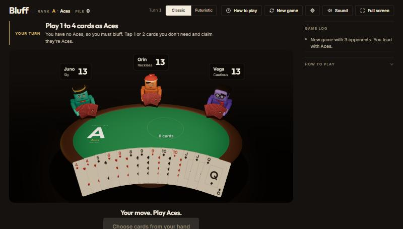

# Bluff

[](https://github.com/callumtsungu200-coder/bluff/actions/workflows/ci.yml)

**[▶ Play Bluff in your browser](https://callumtsungu200-coder.github.io/bluff/)**

A 3D card game about lying well and catching liars. You play the card game Bluff (also called Cheat) against three computer opponents, each with its own personality, around a table rendered in WebGL.



## How the game works

All 52 cards are dealt between you and up to three opponents. Each turn asks for the next rank (Aces, then Twos, up to Kings, then round again). The player to move puts 1 to 4 cards face down and claims they are all that rank. They may be lying.

Anyone can call bluff. If the claim was a lie, the player who made it picks up the whole pile. If it was honest, the caller picks it up. The first player to empty their hand without being caught wins.

## Features

- **Three opponents with different personalities.** Vega is cautious, Orin is reckless and Juno is sly. Each has its own odds of slipping in an extra card, bluffing with two cards and calling bluff.
- **Opponents only see what a player could see.** Bots decide from a `publicView` that holds their own hand and public information only: hand sizes, the pile size and the last claim. They always call a claim that their own hand proves impossible, and they are more suspicious of big claims and of players close to winning.
- **3D table** built with React Three Fiber: animated card flights, a reveal sequence, holograms, celebrations and post-processing.
- **Two themes,** Classic and Futuristic. The card faces are drawn in code with the Canvas 2D API, with no image files.
- **Synthesised sound** with the Web Audio API, so there are no audio files to load.
- **Keyboard shortcuts:** Enter to play or continue, B to call bluff, L to let it go, F for full screen, M to mute.
- **Lifetime stats and settings** (game speed and mute) saved in the browser.
- Respects `prefers-reduced-motion`.

## Tech stack

React 19, Three.js through React Three Fiber and drei, `@react-three/postprocessing`, react-spring for animation, Zustand for state and Vite 8. Tests run on Node's built-in test runner, so they need no extra packages.

## Architecture

```
src/
  game.js          the rules and the bots: pure functions, no React, no DOM
  store.js         Zustand store: holds the game state, paces bot turns, drives animation
  App.jsx          loading screen, setup screen, then the table
  scene/           the 3D table: cards, hands, pile, avatars, lights, effects
  ui/              the HTML overlay: top bar, action bar, log, reveal, settings, help
  audio.js         Web Audio sound effects
  settings.js      persisted settings (speed, mute)
  stats.js         persisted win/loss record
```

The main design decision is that **`game.js` is pure**. Every action, such as `playCards`, `callBluff` or `passChallenge`, takes a state and returns a new one without changing the old one. Illegal moves throw. That keeps the rules easy to test and means the module could move to a server for online play unchanged. `store.js` is the only place that knows about timing: it calls the bot functions after a "thinking" delay and hands the new state to the scene and the overlay.

## Running it locally

Requires Node 20.19+ or 22.12+ (Vite 8's minimum).

```bash
npm install
npm run dev          # http://localhost:5173
```

| Command | What it does |
| --- | --- |
| `npm test` | Rules tests (`src/game.test.js`) and card-art data checks |
| `npm run build` | Production build to `dist/` |
| `npm run preview` | Serve the production build |

The game needs no environment variables or back end.

### Debug URL flags

`?auto=1` skips the setup screen and deals straight away, `&fast=1` skips card flights, `&theme=classic` or `&theme=future` picks a theme, and `&bots=1` to `3` sets the number of opponents.

## Tests

`src/game.test.js` checks the deal, move validation, immutability, both outcomes of a bluff call, the win conditions, that bots never see hidden cards, and that a seeded all-bot game always ends with one winner and all 52 cards accounted for. `src/scene/cardArt.test.js` checks that the card-art tables are complete for both themes. Both run in CI on every push.

## Known limitations

- Single player against bots only. There is no online multiplayer yet.
- The production bundle is large (about 400 kB gzipped) because Three.js and the post-processing effects load up front.
- No hosted version yet.

## What's next

- Online multiplayer, running `game.js` on a server.
- Adjustable bot difficulty.
- Code-splitting the 3D scene to cut the first load.
- Deploying a public demo.
